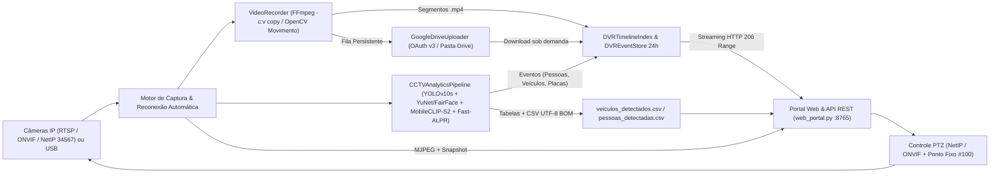

<div align="center">

# HomeCam Segurança NVR & AI

**Sistema Open-Source completo de monitoramento CFTV, gravação contínua DVR, Inteligência Artificial em tempo real (Pessoas, Vestuário, Animais, Veículos e Placas ALPR), backup automático no Google Drive e servidor 24/7 com Portal Web.**

[](https://www.python.org/)
[](https://opencv.org/)
[](https://onnxruntime.ai/)
[](https://ffmpeg.org/)
[](./Dockerfile)
[](./LICENSE)
[](#)

</div>

---

## Visão Geral e Propósito

O **HomeCam Segurança** transforma um PC comum, Mini PC, servidor Linux ou container Docker em um **gravador NVR/DVR inteligente Open-Source**, eliminando mensalidades de nuvem proprietária sem abrir mão de recursos profissionais de vigilância eletrônica:

- Funciona tanto como **aplicativo Desktop completo** (`Tkinter`, com 5 abas operacionais) quanto como **motor autônomo 24/7 (`--headless`)** desacoplado da janela gráfica e acessível remotamente por **Portal Web / API REST** no PC ou celular.
- Compatível nativamente com câmeras IP **RTSP**, **ONVIF**, **Xiongmai NetIP / iCSee (porta `34567`)** e **Webcams USB**.

---

## Arquitetura do Sistema e Fluxo de Dados



---

## Funcionalidades Implementadas

### 1. Conexão Multi-Protocolo, Descoberta LAN e PTZ Inteligente
- **Descoberta automática na rede local:** varredura **ONVIF WS-Discovery** + scan rápido de portas IP (incluindo porta nativa `34567` Xiongmai/iCSee).
- **Xiongmai NetIP / DVRIP nativo (`34567`):** conecta mesmo em câmeras onde o RTSP (`554`) está desativado, com busca automática de IP por **N.º de Série** e fallback automático RTSP -> NetIP.
- **Perfis prontos:** `Xiongmai NetIP / iCSee`, `Xiongmai / General / XMEye`, `Intelbras / Dahua`, `Hikvision`, `TP-Link Tapo`, `Genérico RTSP` e `Webcam USB`.
- **PTZ & Ponto Fixo (`#100`):** controle em 8 direções + zoom + velocidade (`1–8`) via **NetIP** ou **ONVIF SOAP**, presets salvos, retorno automático pós-rastreamento via firmware (`Detect.DetectTrack`) ou temporizador do app.
- **Segurança local:** senhas criptografadas em disco com **Windows DPAPI** (`dpapi:...` no `config.json`) e suporte a variáveis de ambiente em containers/Linux.

### 2. Pipeline de Inteligência Artificial & Melhoria Visual em Tempo Real
- **Detecção e rastreamento multiobjeto:** **YOLOv10s ONNX** (priorizando GPU via `DmlExecutionProvider` no Windows ou CPU) associado ao rastreador preditivo **`ClassAwareIoUTracker`**, identificando **Pessoas**, **Animais**, **Carros/Utilitários**, **Motos** e **Bicicletas** com overlays opcionais ao vivo (sem alterar os `.mp4` gravados).
- **Atributos de Pessoas (Gênero + Cor das Roupas):** detector facial **YuNet** + **FairFace FP16** (com fallback corporal **MobileCLIP-S2** e votação ponderada por qualidade) classifica **`Homem`** / **`Mulher`** e extrai a cor predominante das vestimentas **Superior** e **Inferior** em **CIELAB + HSV** com supressão de tom de pele e modo infravermelho (IR).
- **Leitura de Placas (ALPR/ANPR) + Refinamento Veicular:**
  - **Fast-ALPR** (`yolo-v9-t-384-license-plate-end2end` + `cct-xs-v2-global-model`) com normalização para padrão brasileiro **Antigo (`AAA-0000`)** e **Mercosul (`AAA0A00`)**.
  - **Pré-processamento e upscaling de imagem:** reamostragem bicúbica (`1.6x`, `cv2.INTER_CUBIC`) automática para recortes menores que `240px` antes do OCR de placas, resize bicúbico `224×224` para análise facial e **`letterbox` + TTA multi-view** no **MobileCLIP-S2** (`15` categorias de carros, utilitários e motos).
  - Estimativa perceptual de cor do veículo por região (resistente a vidros, sombras e câmera noturna IR) com votação temporal.
- **Tabelas Dinâmicas + CSV:** atualização em tempo real e exportação em CSV (`;` UTF-8 BOM) para veículos e pessoas.

### 3. Gravação Contínua, Linha do Tempo DVR 24h e Player Profissional
- **Gravação resiliente:** clipes MP4 segmentados (1–15 min) via **FFmpeg** sem recodificação pesada (`-c:v copy` quando compatível) ou gravação somente por movimento via OpenCV (`MotionDetector`), com validação estrutural ISO/MP4 (`moov`/`mdat`) e quarentena automática de arquivos inválidos (`_corrompidos`).
- **Linha do tempo visual de 24 horas:** escalas interativas (`24h`, `6h`, `2h`, `1h`, `15m`), *timeline scrubbing* fluido e marcadores por cores (**Contínua**, **Movimento**, **IA Pessoa**, **IA Animal**, **IA Veículo/Placa ALPR** e **Backup Google Drive**).
- **Controles avançados de playback:**
  - **Play/Pause** (`Espaço`), velocidades frente e ré **`-16x`, `-8x`, `-4x`, `-2x`, `-1x`, `+1x`, `+2x`, `+4x`, `+8x`, `+16x`** com **cache LRU de GOP** para retrocesso sem engasgos.
  - Navegação exata **Quadro a Quadro (`-1 / +1 Frame`)** via botões ou teclas `←` / `→`.
  - **Zoom Digital (`1.0x` até `10.0x`) & Pan** interativo na própria imagem reproduzida + mini-mapa **PiP** + captura de foto do quadro.

### 4. Backup em Nuvem (Google Drive) & Operação 24/7 Desacoplada
- **Google Drive em 2 modos:** API Oficial **OAuth2** (`credentials.json` + download sob demanda para playback) ou pasta local sincronizada pelo **Google Drive para Computador**, com fila persistente (`pending_uploads.json`) e limpeza local opcional após confirmação.
- **Execução 24/7 Headless + Portal Web:**
  - `headless_nvr.py` roda sem `tkinter`, com **`WindowsPowerGuard`** (`SetThreadExecutionState`) mantendo CPU, GPU, rede e disco ativos mesmo com monitor desligado ou tela bloqueada (`Win+L`).
  - **Portal Web embutido** (`web_portal.py`, porta padrão `8765`) responsivo para navegador Desktop e Celular com stream ao vivo MJPEG, controle PTZ, timeline DVR 24h com streaming **HTTP `206 Partial Content` (`Range`)**, tabelas de veículos/pessoas e exportação CSV.

---

## Layout da Interface & Capturas de Tela

### Diagrama Visual da Interface (Visão Geral das Abas Principais)

```text
+---------------------------------------------------------------------------------------------------+
| HomeCam Seguranca       Camera: [Camera Principal v]  [> Conectar] [o Gravar] [IA: Ativa]  [AO VIVO] |
+---------------------------------------------------------------------------------------------------+
| [ Ao Vivo & Gravacao ] [ Reproducao DVR (Timeline) ] [ Cameras ] [ Google Drive ] [ IA & Veiculos ] |
+---------------------------------------------------------------------------------------------------+
| ABA 1: AO VIVO & GRAVACAO                                       | PAINEL LATERAL PTZ              |
|  +-----------------------------------------------------------+  |  Velocidade: [5]                |
|  |   [YOLOv10s + ALPR + Pessoa/Vestuario Overlays]           |  |      [↖]  [▲]  [↗]             |
|  |   Pessoa #1: Mulher | Sup: Azul | Inf: Preto              |  |      [◀]  [■]  [▶]             |
|  |   Carro #2: BRA2E19 | Vermelho | SUV / Crossover          |  |      [↙]  [▼]  [↘]             |
|  +-----------------------------------------------------------+  |  [Zoom +] [Zoom -]              |
|  Clipes: [5] min  [ ] Movimento  [o] Gravando seg_14-00.mp4     |  Ponto Fixo #100 / Auto-Retorno   |
+---------------------------------------------------------------------------------------------------+
| ABA 2: REPRODUCAO DVR (TIMELINE 24H)                                                              |
|  Filtro: [Camera] [2026-11-13] [v Incluir Drive] [Movimento] [IA Pessoas] [IA Veiculos/Placas]    |
|  +----------------------------------------------+  +-------------------------------------------+  |
|  | PLAYER DVR (Zoom Digital 1x-10x + Pan + PiP) |  | Lista de Eventos / Clipes do Dia          |  |
|  | 14:02:18 • REPRODUZINDO • +1x • Zoom 2.5x    |  | 14:02:15 | Placa ALPR | Carro BRA2E19     |  |
|  +----------------------------------------------+  +-------------------------------------------+  |
|  Transporte: [|< Evento] [<< Re] [<| -1 Fr] [▶ Play] [+1 Fr |>] [>> +16x] [Foto]                 |
|  Timeline [24h][6h][2h][1h][15m]: 00h |====[Azul: Local]====[Ciano: Drive]===[▲IA]===[■Mov]== 24h |
+---------------------------------------------------------------------------------------------------+
| ABA 5: IA & VEICULOS (ALPR) — Tabelas Consolidadas em Tempo Real                                  |
|  Log Consolidado de Veiculos (CSV Automatico)     | Pessoas & Vestuario (CSV Automatico)          |
|  Timestamp | Tipo | Placa | Cor | Modelo Aprox.   | Timestamp | Tipo (Homem/Mulher) | Cor Roupas  |
+---------------------------------------------------------------------------------------------------+
```

### Capturas de Tela da Aplicação

> Para publicar suas próprias imagens no repositório, salve os arquivos na pasta [`./docs/screenshots/`](./docs/screenshots/README.md) usando os nomes abaixo (ocultando placas reais ou IPs privados antes do push).

#### 1. Monitoramento ao Vivo, Gravação Contínua e Controle PTZ

> **Legenda técnica:** Área central de visualização em tempo real renderizando caixas delimitadoras e rótulos do pipeline ONNX (`Pessoa #track`, `Carro #track`, placa, cor e vestuário) sem gravar os desenhos no arquivo `.mp4`. À direita, painel **PTZ & Ponto Fixo (`#100`)** com controle direcional em 8 eixos, zoom óptico/digital da câmera e retorno automático configurável pós-rastreamento (`Detect.DetectTrack`). Na faixa inferior ficam a seleção de duração de segmento (`1–15 min`), modo somente movimento, status da gravação ativa e log de eventos.

#### 2. Tabelas Dinâmicas de Veículos (ALPR) e Pessoas / Vestuário

> **Legenda técnica:** Aba **IA & Veículos (ALPR)** exibindo duas tabelas espelhadas em tempo real: à esquerda, **`Log Consolidado de Veículos`** (`Timestamp`, `Tipo de Veículo`, `Placa`, `Cor`, `Modelo Aproximado`) alimentado por Fast-ALPR c/ upscaling `1.6x`, votação CIELAB/HSV e MobileCLIP-S2; à direita, tabela de **`Pessoas e Vestuário`** (`Timestamp`, `Tipo (Homem/Mulher)`, `Cor das Roupas` superior/inferior). Inclui teste avulso por arquivo de imagem e exportação/abertura imediata dos respectivos `.csv`.

#### 3. Player de Gravação DVR com Linha do Tempo de 24h, Zoom e Pan

> **Legenda técnica:** Aba **Reprodução DVR (Timeline)** reproduzindo gravações locais e segmentos armazenados no Google Drive (baixados sob demanda para `_playback_cache`). O player suporta **Zoom Digital (`1.0x–10.0x`)** com arrasto panorâmico (**Pan**) e mini-mapa **PiP** no canto, barra cronológica contínua de `00:00–24:00` com escalas (`24h` a `15m`), marcadores codificados por cor (`Movimento`, `IA Pessoas`, `IA Animais`, `IA Veículos/Placas`), avanço/retrocesso quadro a quadro (`±1 Frame`) e reprodução acelerada ou reversa (`-16x` até `+16x`).

#### 4. Portal Web Remoto 24/7 (Acesso por Navegador Desktop e Celular)

> **Legenda técnica:** Interface Web servida pelo módulo `web_portal.py` (`http://SEU-SERVIDOR:8765/`) enquanto o motor headless (`main.py --headless`) opera em segundo plano sem interface Desktop. Apresenta telemetria (`WindowsPowerGuard`, FPS, gravação ativa, fila Drive), preview ao vivo via `/api/stream/live.mjpg`, pad PTZ remoto, player HTML5 com streaming **HTTP `Range 206`** e tabelas sincronizadas via API REST JSON/CSV protegida por `HOMECAM_WEB_TOKEN`.

---

## Guia de Instalação e Execução (Getting Started)

### Pré-requisitos
- **Python 3.11+** (`python --version`)
- **Git** instalado no sistema
- **FFmpeg** (opcional no PATH — `imageio-ffmpeg` também é instalado automaticamente via `requirements.txt`)
- Para aceleração por GPU:
  - **Windows (AMD / Intel / NVIDIA):** `onnxruntime-directml` já incluído em `requirements.txt`
  - **Linux / Docker com NVIDIA CUDA:** substituir por `onnxruntime-gpu` (via `ORT_PACKAGE=onnxruntime-gpu` no Docker)

### 1. Clonar e Preparar Configuração Segura
```bash
git clone https://github.com/SEU-USUARIO/HomeCamSeguranca.git
cd HomeCamSeguranca
```

Crie sua configuração inicial a partir do modelo sanitizado:
- **Windows (PowerShell):**
  ```powershell
  Copy-Item config.example.json config.json
  Copy-Item .env.example .env
  ```
- **Linux / macOS:**
  ```bash
  cp config.example.json config.json
  cp .env.example .env
  ```

### 2. Instalar Dependências no Ambiente Virtual
- **Windows (PowerShell):**
  ```powershell
  python -m venv .venv
  .\.venv\Scripts\Activate.ps1
  python -m pip install --upgrade pip
  pip install -r requirements.txt
  ```
- **Linux:**
  ```bash
  python3 -m venv .venv
  source .venv/bin/activate
  pip install --upgrade pip
  grep -vi "onnxruntime-directml" requirements.txt > /tmp/req-linux.txt
  echo "onnxruntime>=1.18.0" >> /tmp/req-linux.txt
  pip install -r /tmp/req-linux.txt
  ```

> **Observação sobre os modelos de IA:** os pesos ONNX (`yolov10s`, `yunet`, `fairface`, `mobileclip_s2` e modelos `fast-alpr`) são baixados automaticamente na pasta local `models/` (ou cache Hugging Face) na primeira inicialização da IA, mantendo o repositório Git leve.

### 3. Executar Localmente (Desktop GUI ou Servidor 24/7)
- **Interface Desktop Completa (`Tkinter`):** dê duplo clique em `iniciar.bat` (Windows) ou execute:
  ```powershell
  .\.venv\Scripts\python.exe main.py
  ```
- **Motor Headless 24/7 + Portal Web Remoto (`http://localhost:8765/`):** dê duplo clique em `iniciar_servidor_24h.bat` ou execute:
  ```powershell
  .\.venv\Scripts\python.exe main.py --headless --web-port 8765
  ```

### 4. Executar em Segundo Plano 24/7 (Windows / Docker / Linux)

#### Opção A — Serviço Automático e Energia no Windows (Continua gravando com tela bloqueada `Win+L`)
```powershell
powershell -ExecutionPolicy Bypass -File .\deploy\windows\configurar_energia_24h.ps1
powershell -ExecutionPolicy Bypass -File .\deploy\windows\instalar_servico_24h.ps1
```

#### Opção B — Docker & Docker Compose (Mini PC, Servidor Local ou Cloud VPS)
Edite o arquivo `.env` definindo `HOMECAM_CAM_PASSWORD`, `HOMECAM_WEB_TOKEN` (e `HOMECAM_RTSP_URL` caso use túnel VPN Tailscale) e suba o container:
```bash
docker compose up -d --build
```

#### Opção C — Serviço `systemd` em Linux (Ubuntu/Debian, Jetson Orin, Raspberry Pi)
Adapte o caminho `/opt/homecam/HomeCamSeguranca` em [`deploy/linux/homecam-nvr.service`](./deploy/linux/homecam-nvr.service) e ative:
```bash
sudo cp deploy/linux/homecam-nvr.service /etc/systemd/system/
sudo systemctl daemon-reload
sudo systemctl enable --now homecam-nvr.service
```

---

## Como Configurar o Google Drive (`credentials.json`)

Você pode escolher na aba **Google Drive (Backup)** entre:
1. **Pasta Google Drive para Computador** (sem `credentials.json`): aponte para sua pasta local do Google Drive Desktop.
2. **API Direta OAuth2 (`credentials.json`):**
   1. Acesse o [Google Cloud Console](https://console.cloud.google.com/) e crie um projeto.
   2. Em **APIs e Serviços > Biblioteca**, ative a **Google Drive API**.
   3. Configure a **Tela de permissão OAuth** (`Externo` + adicione seu e-mail em `Usuários de teste`).
   4. Em **Credenciais > + Criar Credenciais > ID do cliente OAuth**, escolha **App para computador (`Desktop app`)**.
   5. Baixe o JSON, salve fora do Git (ex.: `secrets/credentials.json`) e conecte pelo assistente do próprio aplicativo.

---

## Estrutura do Repositório

```text
HomeCamSeguranca/
├── main.py                        # Ponto de entrada (--check, --headless, --web-port, --config)
├── app_gui.py                     # Interface Desktop Tkinter (5 abas, Player DVR, Tabelas IA e PTZ)
├── headless_nvr.py                # Motor autônomo 24/7 + WindowsPowerGuard
├── web_portal.py                  # Servidor HTTP/REST embutido + Portal Web HTML5 responsivo
├── ai_analytics.py                # Pipeline YOLOv10s, YuNet, FairFace, MobileCLIP-S2 e Fast-ALPR
├── dvr_playback.py                # Indexador timeline 24h, DVREventStore, cache GOP LRU e Zoom/Pan
├── recorder.py                    # Gravação segmentada FFmpeg (-c:v copy) e movimento OpenCV
├── camera_discovery.py            # ONVIF WS-Discovery, scan LAN, perfis RTSP e fallback NetIP
├── xiongmai_netip.py              # Protocolo nativo Xiongmai DVRIP/NetIP (porta 34567)
├── ptz_control.py                 # Abstração unificada PTZ (Xiongmai NetIP + ONVIF SOAP)
├── gdrive_uploader.py             # Fila persistente, upload resumível Drive API v3 e modo pasta
├── config_manager.py              # Persistência atômica JSON, Windows DPAPI e overrides por env
├── assets/
│   └── mobileclip_prompts.npz     # Embeddings de texto pré-computados MobileCLIP-S2
├── deploy/
│   ├── windows/                   # Scripts PowerShell de energia 24h e Tarefa Agendada
│   └── linux/                     # Unit systemd para servidores Linux / Edge AI
├── docs/
│   └── screenshots/               # Capturas de tela da documentação
├── tests/
│   └── test_app.py                # Suíte automatizada unittest (39 testes)
├── Dockerfile & docker-compose.yml
├── config.example.json            # Modelo seguro de configuração sem dados sensíveis
├── .env.example                   # Variáveis de ambiente para Docker/Linux/Cloud
├── CONTRIBUTING.md                # Guia completo de contribuição Open-Source
└── LICENSE                        # Licença MIT
```

---

## Testes Automatizados e Verificação

```powershell
# Suíte completa (39 testes unitários e de integração)
.\.venv\Scripts\python.exe -m unittest discover -s tests -v

# Verificações rápidas de inicialização (Desktop e Headless)
.\.venv\Scripts\python.exe main.py --check
.\.venv\Scripts\python.exe main.py --headless --check
```

---

## Contribuição Open-Source

Contribuições são muito bem-vindas! Seja reportando bugs, adicionando compatibilidade com novas câmeras IP, otimizando pipelines ONNX/TensorRT/Hailo ou aprimorando a interface Web/Desktop:

1. Faça um **Fork** deste repositório.
2. Crie uma branch para sua melhoria: `git checkout -b feature/nova-melhoria`.
3. Siga as instruções e o checklist completo em [**CONTRIBUTING.md**](./CONTRIBUTING.md).
4. Abra um **Pull Request** descrevendo suas alterações e o resultado dos testes.

---

## Licença

Distribuído sob a licença **MIT**. Consulte o arquivo [`LICENSE`](./LICENSE) para mais detalhes.
